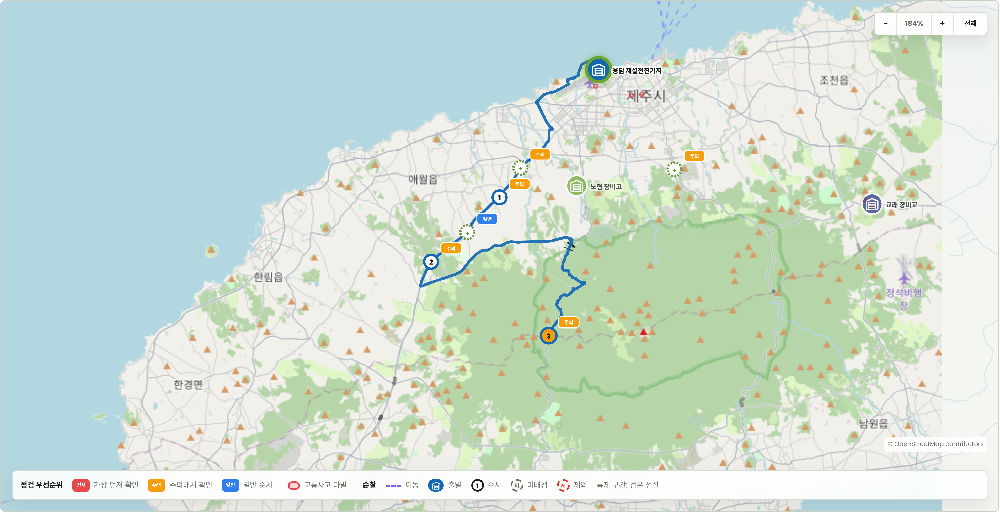

# 결과 설명자료

## 문제와 목표

도로 점검 담당자는 사고·기상·돌발상황을 여러 화면에서 확인한 뒤 제한된 인력과 시간으로 방문 순서를 정해야 합니다. 출동 후 통제가 생기면 완료한 점검 기록을 유지하면서 남은 경로와 소요시간을 다시 검토해야 합니다. RoadOps는 제주데이터허브 자료를 점검 항목과 연결하고 계산 근거와 운영 조건을 함께 보여주는 운영 보조 도구입니다.

## 구조와 주요 기능

공공 API·CSV 수집 → 자료 품질·시점·결합 상태 검사 → 점검 근거·작업 구성 → 자원·이동시간 검토 → 방문 계획 계산 → 결과 재검증 → 담당자 검토의 순서로 진행합니다. Python 도구의 7단계 실행 흐름, React 운영 화면, 방향성 도로망에서 경로를 계산하는 JavaScript Worker로 구성됩니다. 외부 LLM은 현재 연동하지 않았습니다.

구현 기능은 필수 제주 통계·위험지구 조회와 노면별 점검 항목 제안, 우선순위 배점·근거 확인, 거점별 인원·시간·담당/필수/제외 조건, 방문 순서·경로·소요시간, 통제 반영 재계산, 완료 기록 보존, 시간 초과 사전 표시입니다. 화면의 수동 확정은 실제 기관 출동·결재 시스템과 연결되지 않습니다.

## 실제 실행 결과 — 통제 전후 동일 기준

2026-11-19 17:40에 저장한 자료를 사용했으며, 출동 조건은 용담 팀 2명·가용 시간 120분입니다. 광령리 점검을 마친 뒤 소길리→예래동을 방문하는 상황에서 **1100로 방향 링크 `4050000302` 약 398m의 통제**를 가정했습니다. 실제 도로 통제 상황을 재현한 사례는 아닙니다.

| 구성 | 통제 전 | 통제 후 |
|---|---:|---:|
| 광령리 점검 완료까지 사용한 시간(두 안의 공통 가정값) | 39.800분 | 39.800분 |
| 광령리→소길리 이동 | 5.802분 | 5.802분 |
| 소길리 점검 | 15.000분 | 15.000분 |
| 소길리→예래동 이동 | 24.968분 | 50.011분 |
| 예래동 점검 | 15.000분 | 15.000분 |
| 총 예상시간 | **100.570분** | **125.613분** |

같은 이동시간 산정 기준을 적용하면 통제로 25.043분이 추가되고, 남은 이동·점검에는 85.813분이 필요합니다. 총 예상시간은 가용 시간 120분을 5.613분 초과합니다. 발표에서는 각각 25.0·85.8·5.6분으로 표시합니다. 최초 계획의 101.2분은 계산 기준이 달라 통제 전후 비교의 기준값으로 사용하지 않습니다.

통제 전 경로에는 해당 링크가 포함되고, 통제 후 경로에서는 제외됨을 확인했습니다. 방문 지점과 순서를 유지한 상태에서 소길리→예래동의 경로 링크 목록과 지도에 표시된 경로가 달라집니다. 두 지도는 같은 범위와 배율로 비교했으며, 실제 앱이 계산해 표시한 화면을 캡처했습니다. 모든 방문을 유지하면 가용 시간을 초과하므로 검토용 계획만 제시하고 확정은 차단합니다. 이를 통해 **담당자는 다음 지점으로 이동하기 전에 예상 초과시간을 확인하고, 시간 연장이나 지원 투입이 필요한지 판단할 수 있습니다.**

## 검증 방법

| 검증 | 확인 범위·증거 |
|---|---|
| Python 회귀 테스트 | 총 241개: 기능 테스트 238개와 제출 보조 도구 테스트 3개. 자료 품질·통계·점수·자원·배분·경로·Agent·점검 근거·패키지 무결성 등을 확인 |
| 웹 회귀 테스트 | 46개: 제약·작업계획·통제·점수·예보·점검 근거 등 |
| 독립 경로 대조 | Python CSV 라우터와 JS JSON 라우터로 전후 4개 이동 구간의 링크 목록·시간 대조 |
| 실제 브라우저 | 실제 입력·버튼·Worker 계산, 100.6/125.6/25.0/5.6 표시, 지도 SVG 선 변경·동일 viewBox·초과 확정 차단 |
| 배포물 재현 | 격리 폴더에서 실행·소스 빌드·캐시 Agent·필수 자료 로딩·파일 해시·ZIP CRC 검사 |
| 시각 점검 | 최종 PDF 15페이지 렌더링, 페이지 순서·12/13장 경로와 시간·14장 구현/계획 구분 확인 |

최종 실행 횟수·환경·결과는 `evidence/validation.json`, 로그와 계산 JSON은 `evidence/`에 보관합니다. 단위 테스트 통과를 실제 현장 효과나 사고 감소의 입증으로 표현하지 않습니다.

## 한계와 센터 활용

통제 전후 비교의 이동시간은 제한속도를 사용해 추정하며, 제한속도가 없는 구간에는 기본속도를 적용합니다. 실시간 혼잡·신호대기·회전 제한·거점 복귀시간은 포함하지 않습니다. 두 안에 공통으로 적용한 완료시간 39.8분은 실측값이 아닙니다. 도로망에 없는 임도·진입로의 상태, 실제 통제 여부와 현장 안전은 담당자가 확인해야 합니다.

노면별 사고 통계는 노출량 분모가 없어 사고 발생 확률을 계산하지 않습니다. 좌표 없는 위험지구는 행정지역 참고에만 사용합니다. 연도·수집 범위가 다른 사고 자료를 합산하지 않습니다. 누락 자료는 확인된 0점과 구분합니다.

현재 검증은 개발 환경의 기능 재현입니다. 센터 최소 PC(i7-8700, RAM 32GB, GTX 1060/VRAM 3GB)에서의 실제 설치·응답속도·장시간 안정성은 미검증입니다. CPU 기반 저장 자료 실행을 먼저 검증하고, 기관별 키·외부망 연결·서버 저장·권한을 확인한 뒤 시범 운영을 추진합니다. LLM은 요청 해석·설명 보조로 연동하고 수치·경로 결정과 최종 출동 판단을 별도로 검증할 계획입니다.
